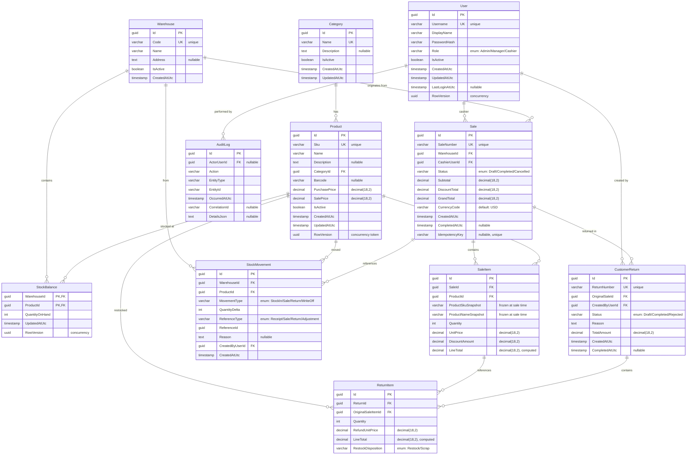

# Database Schema

## ER Diagram

## Table Details

### Category
| Column | Type | Constraints |
|---|---|---|
| Id | guid | PK, DEFAULT gen_random_uuid() |
| Name | varchar(100) | NOT NULL, UNIQUE |
| Description | text | nullable |
| IsActive | boolean | NOT NULL, DEFAULT true |
| CreatedAtUtc | timestamp | NOT NULL |
| UpdatedAtUtc | timestamp | NOT NULL |

### Product
| Column | Type | Constraints |
|---|---|---|
| Id | guid | PK |
| Sku | varchar(50) | NOT NULL, UNIQUE INDEX |
| Name | varchar(200) | NOT NULL |
| CategoryId | guid | FK → Category(Id), NOT NULL |
| Barcode | varchar(50) | nullable |
| PurchasePrice | decimal(18,2) | NOT NULL, >= 0 |
| SalePrice | decimal(18,2) | NOT NULL, >= 0 |
| IsActive | boolean | NOT NULL, DEFAULT true |
| RowVersion | uuid | concurrency token (regenerated Guid) |

### StockBalance
Composite PK: `(WarehouseId, ProductId)`.

| Column | Type | Constraints |
|---|---|---|
| WarehouseId | guid | PK, FK → Warehouse(Id), ON DELETE CASCADE |
| ProductId | guid | PK, FK → Product(Id), ON DELETE CASCADE |
| QuantityOnHand | int | NOT NULL, >= 0 |
| RowVersion | uuid | concurrency token (regenerated Guid) |

### StockMovement
| Column | Type | Constraints |
|---|---|---|
| Id | guid | PK |
| WarehouseId | guid | FK → Warehouse(Id) |
| ProductId | guid | FK → Product(Id) |
| MovementType | varchar(20) | NOT NULL, CHECK IN ('StockIn','Sale','Return','WriteOff') |
| QuantityDelta | int | NOT NULL, != 0 |
| ReferenceType | varchar(20) | NOT NULL |
| ReferenceId | guid | NOT NULL |
| CreatedAtUtc | timestamp | NOT NULL |

**Indexes:** `IX_StockMovement_WarehouseProduct (WarehouseId, ProductId)`, `IX_StockMovement_CreatedAt (CreatedAtUtc)`.

### Sale
| Column | Type | Constraints |
|---|---|---|
| Id | guid | PK |
| SaleNumber | varchar(20) | NOT NULL, UNIQUE |
| WarehouseId | guid | FK → Warehouse(Id) |
| CashierUserId | guid | FK → User(Id) |
| Status | varchar(20) | NOT NULL, DEFAULT 'Draft' |
| Subtotal | decimal(18,2) | NOT NULL |
| DiscountTotal | decimal(18,2) | NOT NULL |
| GrandTotal | decimal(18,2) | NOT NULL |
| IdempotencyKey | varchar(100) | nullable, UNIQUE INDEX |

### SaleItem
| Column | Type | Constraints |
|---|---|---|
| Id | guid | PK |
| SaleId | guid | FK → Sale(Id), CASCADE DELETE |
| ProductId | guid | FK → Product(Id) |
| ProductSkuSnapshot | varchar(50) | NOT NULL |
| ProductNameSnapshot | varchar(200) | NOT NULL |
| Quantity | int | NOT NULL, > 0 |
| UnitPrice | decimal(18,2) | NOT NULL |
| DiscountAmount | decimal(18,2) | NOT NULL, DEFAULT 0 |
| LineTotal | decimal(18,2) | computed: (UnitPrice * Quantity) - DiscountAmount |

### CustomerReturn
| Column | Type | Constraints |
|---|---|---|
| Id | guid | PK |
| ReturnNumber | varchar(20) | NOT NULL, UNIQUE |
| OriginalSaleId | guid | FK → Sale(Id) |
| Status | varchar(20) | NOT NULL |
| Reason | text | NOT NULL |
| TotalAmount | decimal(18,2) | NOT NULL |
| CreatedAtUtc | timestamp | NOT NULL |
| CompletedAtUtc | timestamp | nullable |

### ReturnItem
| Column | Type | Constraints |
|---|---|---|
| Id | guid | PK |
| ReturnId | guid | FK → CustomerReturn(Id), CASCADE DELETE |
| OriginalSaleItemId | guid | FK → SaleItem(Id) |
| Quantity | int | NOT NULL, > 0 |
| RefundUnitPrice | decimal(18,2) | NOT NULL |
| RestockDisposition | varchar(20) | NOT NULL, CHECK IN ('Restock','Scrap') |

### User
| Column | Type | Constraints |
|---|---|---|
| Id | guid | PK |
| Username | varchar(50) | NOT NULL, UNIQUE INDEX |
| DisplayName | varchar(100) | NOT NULL |
| PasswordHash | varchar(200) | NOT NULL |
| Role | varchar(20) | NOT NULL, CHECK IN ('Admin','Manager','Cashier') |
| IsActive | boolean | NOT NULL, DEFAULT true |
| RowVersion | uuid | concurrency token (regenerated Guid) |

### AuditLog
| Column | Type | Constraints |
|---|---|---|
| Id | guid | PK |
| ActorUserId | guid | FK → User(Id), nullable (system actions) |
| Action | varchar(100) | NOT NULL |
| EntityType | varchar(50) | NOT NULL |
| EntityId | varchar(50) | NOT NULL |
| OccurredAtUtc | timestamp | NOT NULL |
| CorrelationId | varchar(50) | nullable |
| DetailsJson | text | nullable |

## Key Design Decisions

1. **Decimal(18,2) for all monetary values** — sufficient for retail (10¹⁶ × 0.01 = 100 trillion units of currency)
2. **Snapshots on SaleItem** — ProductSkuSnapshot and ProductNameSnapshot freeze data at sale time; product catalog changes don't retroactively alter historical transactions
3. **LineTotal is computed** — calculated as `(UnitPrice * Quantity) - DiscountAmount`, stored explicitly for query performance
4. **RowVersion for concurrency** — optimistic concurrency: a new Guid is regenerated on every mutation so a concurrent write on a stale copy fails EF Core's concurrency check. Applied to entities that can be concurrently modified (Product price, StockBalance quantity, User profile)
5. **No cascade deletes** — business-critical entities use `DeleteBehavior.Restrict` to prevent accidental data loss
6. **IdempotencyKey** — prevents duplicate sales/returns when clients retry failed requests
7. **Composite index on StockMovement** — optimized for stock-balance lookup by warehouse+product
8. **StockBalance as separate table** — normalized representation of current stock state; rebuilt from StockMovement for auditability